# Assignment 1 Report: ThreatRule Compiler Front-End

> **Evidence note.** The scanner outputs, test results, generated data, timings,
> and graphs in this project are produced by running the supplied scripts on
> this machine. Syntax trees and later compiler-phase examples explicitly marked
> *illustrative* are not claimed as execution output: this deliverable compiles
> and tests the lexical analyzer, not a complete parser or target-code compiler.

## Cover and contents

See [Cover_Page.md](Cover_Page.md). Student and evaluation fields remain blank.

1. [Task 1 — Language processors](#task-1--language-processors)
2. [Task 2 — Compiler phases](#task-2--compiler-phases)
3. [Task 3 — Phase grouping](#task-3--phase-grouping)
4. [Task 4 — Construction tools](#task-4--construction-tools)
5. [Task 5 — Lexical analyzer](#task-5--lexical-analyzer)
6. [Task 6 — Token specification](#task-6--token-specification)
7. [Task 7 — Token recognition](#task-7--token-recognition)
8. [Task 8 — LEX specification](#task-8--lex-specification)
9. [Task 9 — Implementation and tests](#task-9--implementation-and-tests)
10. [Task 10 — Performance](#task-10--performance)
11. [Task 11 — Final design](#task-11--final-design)
12. [Task 12 — Day-4 live-feed challenge](#task-12--day-4-live-feed-challenge)
13. [Appendices and references](#appendices-and-references)

## Project and implementation boundary

ThreatRule is a small, case-insensitive rule-description language for defensive
SOC detection. Its sample program is:

```text
RULE ssh_attack IF src_ip == 10.0.0.5 AND port == 22 AND attempts > 5 THEN ALERT "SSH brute force" ;
```

The actual implementation is the Flex scanner
([threatrule.l](../LEX_Scanner/threatrule.l)); Flex generates
`LEX_Scanner/lex.yy.c`, which GCC compiles. The scanner emits line-numbered
tokens, validates IPv4 octets and port values, interns identifiers in a symbol
table, and reports recoverable lexical errors. A grammar parser, complete
semantic analyzer, optimizer, and target-code emitter are not implemented.
Their roles and phase examples below are theory/design examples, not executable
claims. This is a material limitation of this submission.

## Task 1 — Language processors

| Processor | Input → output | Typical use | Suitability to central SOC |
|---|---|---|---|
| Compiler | Whole source → translated target program | Ahead-of-time translation and diagnostics | **Selected:** validate rule packs before controlled deployment; reusable native engine and batch diagnostics |
| Interpreter | Source plus input → actions at run time | Interactive scripts | Useful for experimentation, but runtime parsing adds latency and can make deployment behavior dependent on interpreter/runtime availability |
| Assembler | Assembly language → machine/object code | Low-level instruction translation | Necessary only if a compiler emits assembly; does not translate ThreatRule semantics directly |
| Hybrid compiler | Source → intermediate/bytecode, then VM/JIT | Portable managed runtimes | Plausible for heterogeneous SOC nodes, at cost of VM and runtime management |
| Preprocessor | Source directives → expanded source | Includes, macros, conditional compilation | Optional configuration stage; not the core ThreatRule translator |
| Linker | Object files/libraries → executable | Resolve symbols and combine modules | Used when linking the generated SOC engine, not for rule syntax |
| Loader | Executable → process image | Load and start a program | Operating-system/runtime service, not a source translator |

A compiler is chosen because rules can be checked and transformed before
deployment, errors can be reported together, and a stable target can be rolled
out to federated SOC nodes. This assumes the SOC can tolerate a compile/deploy
boundary; a live authoring console may still provide an interpreter-like preview.

**Figure 1. ThreatRule language-processing system.** The diagram shows source,
translator, engine, and runtime; it is an architecture, not evidence that all
boxes are implemented.

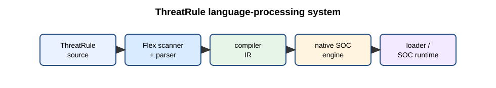

## Task 2 — Compiler phases

### Lexical analysis — actual generated-scanner output

The scanner run on the sample recognizes these 18 tokens:

```text
RULE RULE
IDENTIFIER ssh_attack
IF IF
IDENTIFIER src_ip
EQ ==
IPV4 10.0.0.5
AND AND
IDENTIFIER port
EQ ==
PORT 22
AND AND
IDENTIFIER attempts
GT >
INTEGER 5
THEN THEN
ALERT ALERT
STRING "SSH brute force"
SEMICOLON ;
```

The line-numbered exact output is in
[`Output_Files/token_output.txt`](../Output_Files/token_output.txt). The
identifier table from this scanner run is in
[`Output_Files/symbol_table_output.txt`](../Output_Files/symbol_table_output.txt).

### Syntax analysis — illustrative tree, not parser output

```text
Rule(ssh_attack,
  AND(
    AND(Equal(src_ip, IPv4(10.0.0.5)), Equal(port, Integer(22))),
    Greater(attempts, Integer(5))),
  Alert("SSH brute force"))
```

The actual project stops before this phase; no parser output is generated.

### Semantic analysis

Implemented scanner-level checks: every IPv4 octet is 0–255 and a value
immediately following the `port` field and relational operator is 0–65535.
Those are lexical/attribute checks, not a complete semantic pass. Field
declarations, type compatibility, duplicate rule names, and action policy are
not checked.

### Intermediate code generation and optimization — illustrative

Three-address-code sketch:

```text
t1 = src_ip == 10.0.0.5
t2 = port == 22
t3 = t1 AND t2
t4 = attempts > 5
t5 = t3 AND t4
if t5 goto alert_ssh_attack
```

Illustrative optimization: common-subexpression elimination would reuse a
previously computed identical predicate when one exists. No optimizer runs in
this implementation, and this one-rule input offers no demonstrated
cross-expression reuse.

### Target-code generation — illustrative

```text
LOAD_FIELD r1, src_ip
CMP_IPV4  r1, 10.0.0.5
JNE       next_rule
LOAD_FIELD r2, port
CMP_U16   r2, 22
JNE       next_rule
LOAD_FIELD r3, attempts
CMP_GT    r3, 5
JNE       next_rule
EMIT_ALERT "SSH brute force"
```

These are abstract SOC-engine instructions, not machine code emitted by this
project. A symbol table stores identifier attributes for later phases; this
scanner currently stores distinct identifier spellings. An error handler
attaches line numbers, records diagnostics, skips the invalid lexeme, and
continues scanning where possible. See Figure 2,
[compiler phases](../Diagrams/compiler_phases.svg).

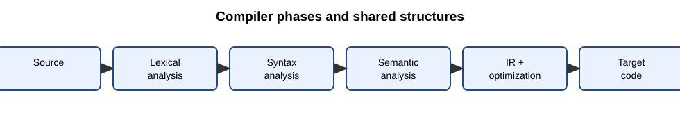

## Task 3 — Grouping of phases

The front end comprises scanning, parsing, and semantic checks and is tied to
ThreatRule syntax and meaning. The back end consumes an intermediate
representation, performs target-oriented optimization, and emits instructions.
An IR boundary allows the same validated rule semantics to target different
SOC engines, while branch SOCs can share the language front end. A *pass* is one
complete traversal/analysis of a representation. A multi-pass design is easier
to diagnose and extend; a one-pass design may reduce work for simple rules but
couples phases and limits optimization. A staged multi-pass design is the
recommended architecture; only the scanning pass is implemented. Figure 3:
[front end and back end](../Diagrams/frontend_backend.svg).

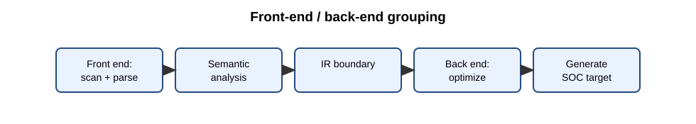

**Figure 4. ThreatRule compiler architecture (implemented scanner and planned stages).**

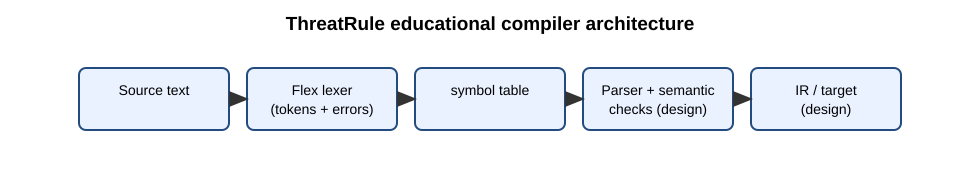

## Task 4 — Compiler construction tools

| Tool class | Purpose | Example | ThreatRule placement |
|---|---|---|---|
| Scanner generator | Convert regular-expression rules to a lexer | LEX/Flex | Used; produces `lex.yy.c` |
| Parser generator | Convert grammar to parser | Yacc/Bison | Not implemented |
| Syntax-directed translation engine | Attach actions/attributes to productions | Bison semantic actions | Design option for AST/IR construction |
| Code-generator generator | Map IR patterns to target instructions | BURG-style tree-pattern selector | Not implemented |
| Data-flow analysis engine | Compute liveness, reaching definitions, etc. | LLVM analyses | Future optimizer |
| Compiler construction toolkit | Reusable IR, passes, target interfaces | LLVM | Possible larger implementation platform |

Flex is preferred to an all-manual scanner here because regular definitions are
visible and auditable, generated DFA-style code handles maximal munch, and
changes to token patterns are reproducible. A hand-written scanner may be
simpler for a tiny stable language, but it transfers boundary and lookahead
maintenance to every developer.

## Task 5 — Lexical analyzer

A token is a category (`IPV4`), a pattern is its accepted character language,
and a lexeme is the concrete source spelling (`10.0.0.5`). Flex discards spaces,
tabs, line breaks, and supported comments while `yylineno` tracks source lines.
The scanner separates token boundaries from grammar structure: it recognizes
`AND`, while a parser would decide whether that operator is legal in a
condition.

A conventional parser consumes returned tokens and may update a shared symbol
table; this project is a standalone scanner and prints tokens. It does not use
`yylval` because no Bison/parser interface is linked. Flex provides buffered
input internally; Figure 6,
[paired buffers and sentinels](../Diagrams/buffer_pair_and_sentinel.svg), is a
conceptual illustration of the classic two-buffer technique, not a claim about
Flex's internal buffer implementation.

**Figure 5. Scanner, parser, and symbol-table interaction (conceptual).**


**Figure 6. Paired input buffers and sentinels (conceptual).**

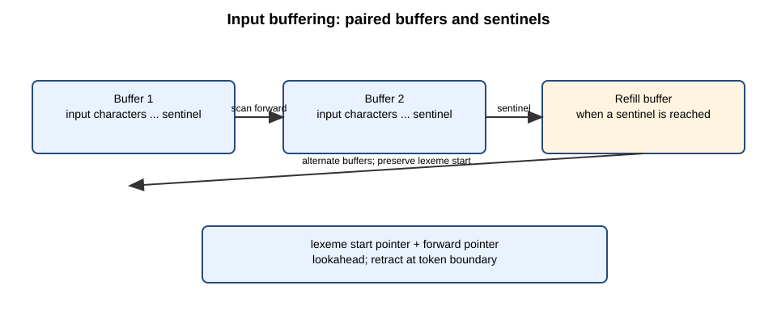

Faulty-input evidence (diagnostics continue in the same file):

| Input | Error | Recovery and evidence |
|---|---|---|
| `src_ip == 10.0.300.5` | IPv4 octet 300 is outside 0–255 | Consume/reject the full dotted lexeme; continue at the next token. See `invalid_errors.txt`. |
| `ALERT "Login failed ;` | Closing quote missing before newline/EOF | Consume the malformed string through the line boundary; report and continue on the next line. |
| `port == 22 @ attempts > 5` | `@` has no token rule | Report one invalid-character diagnostic and continue scanning `attempts > 5`. |

The test inputs contain these cases; exact line-numbered diagnostics are saved
in [`Output_Files`](../Output_Files/).

## Task 6 — Token specification

A string is a finite sequence of alphabet symbols; a language is a set of
strings over an alphabet. Language operations include union, concatenation,
and Kleene closure. A regular expression denotes a regular language and can be
recognized by a finite automaton. A regular definition names reusable regular
expressions such as `DIGIT = [0-9]`.

| Token | Regular definition / pattern | Example | Attribute |
|---|---|---|---|
| Keyword | `RULE|IF|AND|OR|THEN|ALERT|BLOCK` (case-insensitive lookup) | `ALERT` | canonical keyword |
| Identifier | `[A-Za-z_][A-Za-z0-9_]*` | `ssh_attack` | spelling, symbol-table entry |
| Integer | `[0-9]+` | `5` | decimal value |
| IPv4 | `[0-9]+\.[0-9]+\.[0-9]+\.[0-9]+` plus range validation | `255.255.255.255` | four validated octets |
| Port | integer in port context plus 0–65535 check | `65535` | unsigned port |
| String | `\"([^\"\\\n]|\\.)*\"` | `"SSH brute force"` | quoted lexeme |
| Relation | `== != <= >= < > =` | `>=` | operator kind |
| Hash | 32, 40, or 64 hexadecimal digits | 64-char SHA-256 | algorithm by length |
| CVE | `CVE-` + >=4 year digits + `-` + >=1 digit | `CVE-2024-3400` | identifier spelling |
| URL | lowercase `http://` or `https://`, ASCII hostname with nonempty labels (1–63 chars), optional path/query/fragment with no whitespace, quote, semicolon, or comma | `https://example.com/a` | whole URL lexeme |
| Comment | `//...`, `#...`, or `/*...*/` | `# feed` | discarded |

The rule order and the keyword lookup ensure equal-length keyword/identifier
matches resolve as keywords; Flex first chooses the longest match, and breaks
equal-length ties by the first rule. The scanner uses a generic identifier
pattern and case-insensitive keyword lookup.

## Task 7 — Token recognition

Figure 7, [transition diagrams](../Diagrams/token_transition_diagrams.svg),
contains the relational, identifier/keyword, integer, and IPv4 recognition
paths. Relational lookahead distinguishes `<` from `<=`: after `<`, inspect the
next character; consume `=` for `LE`, otherwise retract the lookahead and accept
`LT`. Similar lookahead applies to `>` and `=`.

Hand traces:

1. `src_ip`: start → letter `s` → identifier body; consume `r c _ i p` → delimiter
   whitespace → retract delimiter → accept identifier; table lookup says not a
   keyword.
2. `10.0.0.5`: start → digits `10` → dot → digits `0` → dot → digits `0` → dot →
   digits `5` → delimiter → retract → validate 4 octets → accept IPv4.

The actual Flex engine handles these transitions; the SVG is a teaching model
rather than a generated DFA dump.

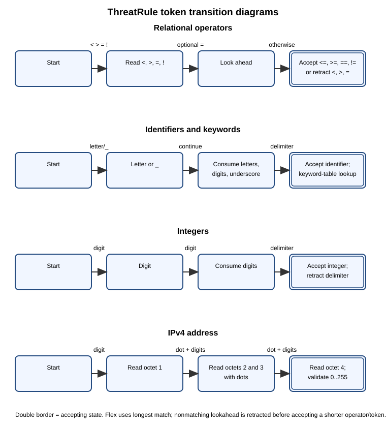

## Task 8 — LEX specification

The complete, compilable and commented source is
[`LEX_Scanner/threatrule.l`](../LEX_Scanner/threatrule.l); the generated source
is [`LEX_Scanner/lex.yy.c`](../LEX_Scanner/lex.yy.c). Definitions name token
patterns; the rules section resolves matches; auxiliary C functions perform
range checks, symbol insertion, printing, and diagnostics.

- `yytext`: current matched lexeme.
- `yyleng`: lexeme length, used when copying a symbol.
- `yylineno`: Flex line counter included in tokens and errors.
- `yylval`: not used because this scanner has no generated parser and returns
  printed tokens instead. A parser integration should define a shared semantic
  value type and assign it for token values rather than inventing a disconnected
  global.

Flex's longest-match rule selects the longest candidate; rule order breaks
ties. `flex threatrule.l` in `LEX_Scanner/` generates `lex.yy.c`; GCC compiles
the generated scanner. The actual generated C compiled successfully with GCC
9.2.0 and Flex 2.5.4. Compiler warnings in generated Flex support code are
tool-generated unused-label/function warnings; no handwritten-source errors
were reported.

## Task 9 — Implementation and tests

The reproducible test runner invokes Flex, compiles its output, and runs the
scanner. The actual test report is
[`Test_Cases/test_results.md`](../Test_Cases/test_results.md); token streams and
stderr logs are in `Output_Files/`. It tests valid and invalid rules,
empty input, IPv4/port boundaries, comments, strings, operators, bad
characters, the extended feed, and legacy-mode behavior. The four generated
rule sets (100, 1,000, 10,000, and 100,000 rules) are produced by
`scripts/generate_inputs.py`. Generated evidence reflects the compiled Flex
scanner, not a Python reference lexer. No execution screenshots are supplied.

**Figure 8. Reproducible scanner testing workflow.**

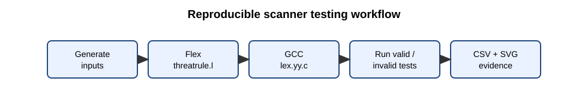

## Task 10 — Performance

The benchmark runs the compiled scanner five times per input and records the
median wall-clock duration using `time.perf_counter`; timing includes fresh
process startup and file I/O. Counts are read from the scanner's own counters.
The machine, OS, compiler, Flex version, and measured table are recorded in
[`Performance_Analysis/performance_report.md`](../Performance_Analysis/performance_report.md),
with machine-readable rows in
[`Performance_Analysis/performance_results.csv`](../Performance_Analysis/performance_results.csv).
Four actual SVG charts are in `Graphs/`: rules/time, rules/tokens,
rules/throughput, and rules/errors. Error counts should be zero for generated
valid files. Timings are local measurements and are not portable guarantees.

**Figures 9a–9d. Actual measured scanner performance.**

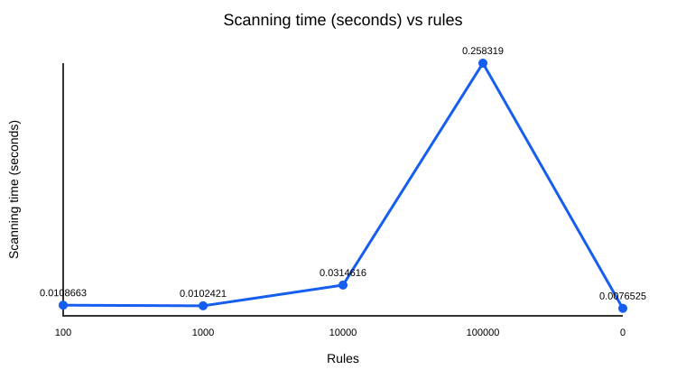
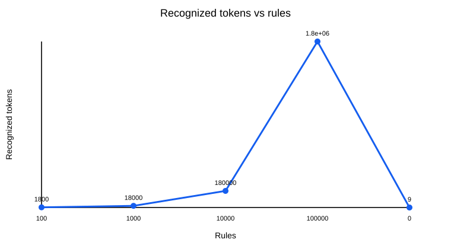
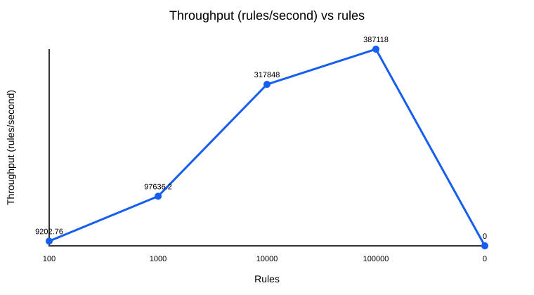
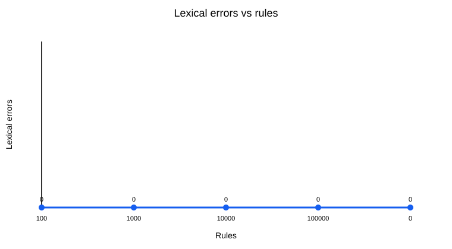

## Task 11 — Final design

The generated scanner is suitable as a transparent lexical front-end prototype:
it accepts 100,000 generated valid rules, counts tokens without retaining token
streams, and reports lexical errors while continuing. Its measured throughput
is in the generated report. This demonstrates input-size handling, not
production SOC suitability: no rule parser, policy/type checker, deployment
safety review, streaming mode, or target engine is supplied. The identifier
table grows with the number of distinct identifiers; scanner input buffering
and Flex's generated automaton use additional memory. Retain the Flex-based
scanner for the course prototype, but require parser/semantic integration and
production-scale profiling before deployment.

## Task 12 — Day-4 live-feed challenge

### 12A. Impact analysis

Hashes, CVE identifiers, and URLs introduce long tokens and lexical overlap
with identifiers, integers, punctuation, and comments. The rules must appear
before shorter component patterns where longest-match does not resolve them;
hashes require format-length and hex validation, CVEs require the `CVE` prefix
and numeric components, and URLs require explicit scheme/host boundaries.
Continuous diagnostics must preserve line numbers and recover after malformed
feed entries.

### 12B. Original-design evaluation

There was no preexisting scanner source in the repository. The `--legacy` mode
in the same Flex source is a controlled compatibility simulation: extended
lexemes produce unsupported diagnostics instead of HASH/CVE/URL tokens. It is
not a separately preserved pre-extension binary. The actual run reports 3
unsupported items and 6 other tokens for the sample feed; the enhanced mode
reports 9 tokens and 0 errors. See
`Output_Files/design_challenge_legacy_errors.txt` and
`Output_Files/design_challenge_tokens.txt`. Therefore the evidence demonstrates
the designed compatibility behavior, not a historical scanner's exact DFA.

### 12C. Adaptation / redesign

The scanner adds HASH, CVE, and URL patterns. Supported hash formats are
MD5/SHA-1/SHA-256 (32/40/64 hex chars); CVE years contain at least four digits,
with a numeric identifier of at least one digit. URLs support lowercase
`http(s)://`, an ASCII hostname, and optional path/query/fragment without
whitespace or the documented excluded punctuation. Invalid extended inputs
produce a line-numbered error, and scanning continues. The actual
`hash_cve_url_feed.tr` execution recognizes the three new token kinds;
`invalid_feed.tr` demonstrates rejection of a malformed host and recovery to
the following CVE and valid URL tokens.

**Figure 10. Day-4 design comparison.**


### 12D. Evidence-based defence

The six actual performance rows include four valid rule-set sizes and the
legacy/enhanced feed comparison. The table and environment are regenerated by
`scripts/benchmark.py`; the original mode has three errors on the feed, while
enhanced mode has none and recognizes three additional tokens. The enhanced
mode costs a small measured runtime difference on this tiny feed; that
difference is dominated by process-start timing and is not sufficient to
recommend a performance conclusion. Keep the extension for required
recognition, and profile repeated in-process scans before optimizing.

## Appendices and references

- **Appendix A — LEX source:** [`threatrule.l`](../LEX_Scanner/threatrule.l).
- **Appendix B — Reproduction:** Windows commands are in [README.md](../README.md);
  scripts are in `scripts/`.
- **Appendix C — Execution outputs:** `Output_Files/` and `Test_Cases/test_results.md`.
- **References:** A. V. Aho, M. S. Lam, R. Sethi, J. D. Ullman,
  *Compilers: Principles, Techniques, and Tools*, 2nd ed.; Flex manual,
  https://westes.github.io/flex/manual/; GCC online documentation,
  https://gcc.gnu.org/onlinedocs/.

## Blank mark sheet

| Task | Marks available | Marks awarded |
|---|---:|---:|
| Tasks 1–11 and 12A–12D | 50 | |
| Faculty comments | | |
| Evaluation date / signature | | |

No marks, signature, viva completion, or evaluation date are asserted here.
